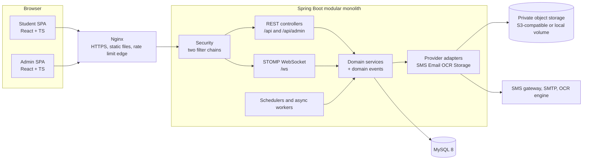
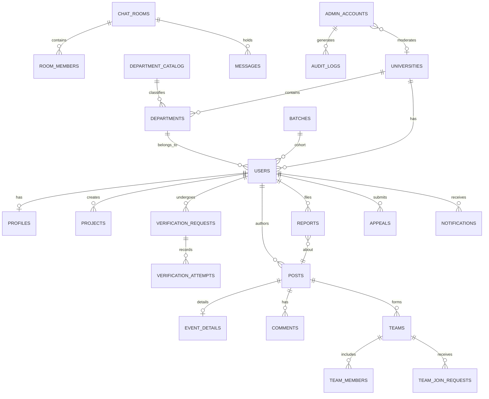
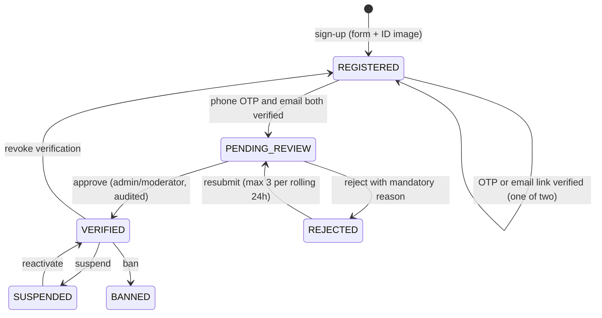

# UniLink Architecture Overview

Read after `REQUIREMENTS_DECISION_LOG.md`. Decisions are cited as D-xxx.

## 1. Style and constraints

- **Modular monolith.** One Spring Boot 3.x (Java 17+, Maven) deployable, one MySQL 8 schema, one React + TypeScript (Vite) front end with two entry points: the student app and the Admin Portal (D-001, D-002, D-005).
- **Single origin.** Nginx terminates HTTPS and serves `/` (student SPA), `/admin` (admin SPA bundle), `/api/**` and `/ws/**` (Spring Boot). No CORS needed (empty allow-list).
- **Server-side sessions** in MySQL (Spring Session JDBC), cookie `UL_SESSION` (D-013). No Redis, broker or search engine in v1.0 (D-003).
- **No premature services.** OCR, SMS, email and storage are in-process adapters behind interfaces, so a provider or a separate service can replace them without touching callers.

## 2. Component diagram



## 3. Backend package structure (feature-first)

```
com.unilink
  UniLinkApplication
  common/            ApiError, ErrorCode, GlobalExceptionHandler (@RestControllerAdvice),
                     Clock provider, PageResponse, IdempotencyKey, validation annotations
  config/            SecurityConfig(student), AdminSecurityConfig, WebSocketConfig, AsyncConfig,
                     SchedulingConfig, OpenApiConfig, PropertiesBinding (@ConfigurationProperties)
  security/          UnilinkUserPrincipal, AdminPrincipal, AccessPolicy (central checks),
                     ScopeResolver (university scope), LoginThrottle, RateLimitFilter,
                     TotpService, CsrfConfig, SecurityHeadersFilter
  identity/          registration, otp, emailtoken, login, password-reset, session, verification
    (api, service, domain, repo, dto, event)
  profile/           profile, project, education, achievement, links, skills, follow
  community/         feed assembly, visibility rules, sector follow
  content/           post, comment, reaction, attachment, bookmark
  event/             event, lifecycle scheduler, response, calendar
  team/              team, join request, state machine
  messaging/         room, member, message, read state, block, mute, WS handlers
  search/            SearchStrategy implementations, specifications
  moderation/        report, auto-hide policy, appeal, strike, moderation queue, chain
  notification/      notification, preferences, delivery strategies, observers
  admin/             admin accounts, moderator assignment, dashboards, analytics, announcements,
                     master data (university, department, catalog, batch, sector), user management
  audit/             AuditLog, AuditService (append-only), hash chain, verifier job
  storage/           StorageGateway (interface) + adapters, upload validation, image sanitising
  integration/       sms/ email/ ocr/ (interfaces + adapters + fake for tests)
  db/migration/      (resources) Flyway V1__..., V2__...
```

Rules: controllers only translate HTTP to a service call and a DTO back; services hold business rules and transactions; repositories hold queries; entities never leave the service layer; constructor injection with `private final` fields; SLF4J parameterised logging; no secrets, OTP values or private file URLs in logs or responses.

## 4. Frontend structure

```
frontend/
  index.html                student entry          admin.html   admin entry
  src/
    app/        providers (query client, theme, auth), router, error boundary
    design/     tokens.css (generated from DESIGN.md), theme.ts, primitives
                (Button, Pill, Field, Modal, StatStrip, RuledList, EmptyState, Skeleton)
    api/        typed client generated from OpenAPI, csrf handling, error mapping
    features/   auth, verification, profile, community, events, posts, teams,
                messages, search, calendar, notifications, bookmarks, reports
    admin/      layout (left rail), auth+2fa, dashboard, verification, users, moderation,
                appeals, events, announcements, master-data, moderators, analytics, audit
    i18n/       English strings; Bangla (UTF-8) input and display verified
    test/       setup, msw handlers (unit tests only)
```

Rules: server state via TanStack Query, no business authority in the client, route guards are UX only, every feature calls the real API, no `localStorage` for anything authoritative (only the optional theme hint before login). All user content is rendered as text; rich text, if any, passes a server-side allow-list sanitiser and `DOMPurify` as a second layer.

## 5. Database design

Charset `utf8mb4`, collation `utf8mb4_0900_ai_ci`, InnoDB, UTC timestamps (`DATETIME(3)` or `TIMESTAMP`). Primary keys `BIGINT UNSIGNED AUTO_INCREMENT` internally; public APIs use opaque ids or UUID columns for resources where enumeration matters (messages, attachments, teams, appeals). The SRS ER diagram is the base; D-062 lists additions. **Tables to create** (grouped):

| Domain | Tables |
|---|---|
| Master data | `universities` (+`email_domains`), `department_catalog`, `departments` (university_id, catalog_id), `batches`, `sector_tags`, `skills`, `system_settings` |
| Identity | `users` (student only), `user_credentials`, `phone_otps`, `email_verification_tokens`, `password_reset_tokens`, `login_attempts`, `verification_requests`, `verification_attempts`, `identity_change_requests`, `spring_session*` |
| Admin | `admin_accounts`, `admin_totp_secrets`, `admin_recovery_codes`, `admin_ip_allowlist`, `suspension_recommendations`, `admin_alerts` |
| Profile | `profiles`, `projects`, `education_entries`, `achievements`, `user_skills`, `user_sector_follows`, `follows` |
| Content | `posts` (type, visibility, scope_university_id, scope_department_id, scope_catalog_id, status, author_id), `event_details`, `comments`, `comment_mentions`, `reactions`, `attachments`, `post_sector_tags`, `bookmarks`, `event_responses` |
| Teams | `teams`, `team_members`, `team_join_requests` |
| Messaging | `chat_rooms` (type: DEPARTMENT, UNIVERSITY, PRIVATE, TEAM, TEMP_GROUP), `room_members` (role, muted_until, last_read_message_id), `messages`, `message_attachments`, `user_blocks` |
| Moderation | `reports`, `report_counters` or derived view, `appeals`, `moderation_events` (strikes), `moderation_snapshots` (reported messages) |
| Notifications | `notifications`, `notification_preferences` |
| Announcements | `announcements` |
| Audit | `audit_logs` (actor_admin_id, action, target_type, target_id, reason, metadata JSON, ip, created_at, prev_hash, row_hash) |

### Relationships and deletion behaviour (summary)
- `departments` -> `universities` RESTRICT; `departments` -> `department_catalog` RESTRICT. Master data is deactivated (`active=false`), never hard-deleted once referenced.
- `users` -> `universities`, `departments`, `batches` RESTRICT. Deleting a user (D-052) is a service-level anonymise-and-delete job in one transaction, not an unqualified `ON DELETE CASCADE` chain.
- `profiles`, `projects`, `education_entries`, `achievements`, `user_skills`, `follows`, `bookmarks`, `reactions`, `room_members` -> `users`: CASCADE on user deletion.
- `posts.author_id` -> `users`: deletion removes the user's posts (CASCADE), `comments` -> `posts` CASCADE.
- `messages.sender_id` -> `users`: SET NULL (sender shown as "Deleted user").
- `reports`, `appeals`, `audit_logs`: no cascade from `users`; targets are stored as `(type, id)` and survive.
- `audit_logs.actor_admin_id` -> `admin_accounts` RESTRICT; admins are deactivated, never deleted.

### Required constraints and indexes
- Unique: `users.email`; `(users.university_id, users.student_id)` (FR-AUTH-02); `follows(follower_id, followed_id)`; `bookmarks(user_id, target_type, target_id)`; `reactions(user_id, target_type, target_id)`; `reports(reporter_id, target_type, target_id)` where active; `team_members(team_id, user_id)`; one team per user per event via a unique on `(event_post_id, user_id)` in a membership-per-event table or trigger-free check in the service inside a transaction with a unique helper column.
- Feed indexes: `(visibility, scope_university_id, scope_department_id, status, created_at, id)`, `(visibility, scope_catalog_id, status, created_at, id)`, `(status, deadline)` on `event_details`, `(author_id, created_at)`.
- Messages: `(room_id, id)` for keyset paging; `room_members(user_id, room_id)`.
- Verification queue: `(status, university_id, submitted_at)`.
- Full-text: `FULLTEXT(posts.title, posts.body)`, `FULLTEXT(users.full_name)` (or a search table), `user_skills(skill_id, user_id)`.
- All lists use keyset pagination, never unbounded `OFFSET` on large tables.

### ER overview (core)



## 6. Security architecture

- **Two Spring Security filter chains**: `@Order(1)` matches `/api/admin/**` and `/admin/**`, authenticates only `AdminPrincipal` and requires the `MFA_VERIFIED` authority; `@Order(2)` handles everything else with `UnilinkUserPrincipal`. A student principal can never satisfy the admin chain because it is a different type loaded from a different table (D-030). Logging into one area ends the other session.
- **Method and resource authorisation**: `AccessPolicy` is the single place that answers "may principal P do action A on resource R". It checks authentication, account state, role, university scope (via `ScopeResolver`) and ownership. Services call it; `@PreAuthorize` is used for coarse role gates only. Out-of-scope resources return 404.
- **Account state gate**: every student write path also requires state `VERIFIED` (FR-AUTH-13, TC-07).
- **WebSocket**: the HTTP session authenticates the STOMP CONNECT; a `ChannelInterceptor` authorises every SUBSCRIBE and SEND against room membership, block lists and account state; rooms are subscribed as `/user/queue/...` or `/topic/room.{uuid}` only after a membership check; sessions are dropped on logout, suspension or password change.
- **Uploads**: size limit, content sniffing (Apache Tika), allow-listed types, re-encode images, random object keys, private bucket, no public ACL, antivirus hook as a documented optional adapter.
- **Headers**: HSTS, CSP (`default-src 'self'`), `X-Content-Type-Options`, `Referrer-Policy`, `Permissions-Policy`, frame denial.
- **Rate limiting**: edge limits in Nginx and application token buckets on login, OTP send, OTP verify, password reset, message send, report, upload (NFR-SEC-05).
- **Secrets**: environment variables only; `.env.example` committed, real values never.

## 7. Key workflows (state and sequence)

### 7.1 Student verification

OCR runs asynchronously (`OcrJob`, retried with backoff). Result and match score are stored on the attempt. OCR failure never blocks the queue (NFR-FLT-03).

### 7.2 Reporting and moderation
Report submitted (verified, not owner, unique per target) -> count distinct reporters -> at threshold (setting, default 5) `ModerationPolicy` transitions the item to `HIDDEN_AUTO` -> owner notified -> item enters the queue with high priority -> admin hides, removes, restores or asks for edit -> appeal path -> every transition audited. Strike counter checks 3 auto-hides in 30 days (FR-REP-04).

### 7.3 Messaging
Create or find a conversation (blocked and state checks) -> persist message (transaction) -> after commit publish to room topic (so no message is delivered that was not stored) -> recipients receive via WebSocket -> read state updated via an explicit "read up to message id" call -> offline recipients get a notification digest.

## 8. Design patterns that earn their place

| Pattern | Where | Problem solved | Key classes |
|---|---|---|---|
| Strategy | OCR provider, SMS provider, search, notification delivery, feed assembly per level | Swap behaviour by configuration without `if` chains | `OcrProvider`, `SmsProvider`, `SearchStrategy`, `DeliveryChannel`, `FeedSourceStrategy` |
| Adapter | SMTP, SMS gateway, OCR engine, S3 or local storage | Isolate vendor APIs and make tests use fakes | `SmtpEmailAdapter`, `GatewaySmsAdapter`, `TesseractOcrAdapter`, `S3StorageAdapter`, `LocalStorageAdapter` |
| Factory Method | Selects the delivery channel and provider implementation from configuration and user preference | Centralise creation and fall back when a provider is down | `DeliveryChannelFactory`, `ProviderResolver` |
| Observer (Spring events) | Domain events such as `StudentVerified`, `PostAutoHidden`, `TeamJoinAccepted`, `MessageSent` | Decouple core transactions from notifications, audit and alerts; use `@TransactionalEventListener(AFTER_COMMIT)` | `ApplicationEventPublisher`, `NotificationEventListener`, `AuditEventListener` |
| State | Account verification, post moderation status, event lifecycle, team lifecycle, appeal | Make legal transitions explicit and testable | `AccountState`, `PostModerationState`, `TeamState` |
| Chain of Responsibility | Content validation pipeline (size, type, links, rate, banned terms) and report eligibility checks | Add or reorder checks without editing one big method | `ContentValidator` chain, `ReportEligibilityHandler` |
| Specification | Composable feed and search filters (visibility, scope, sector, status, date) | One reusable, testable definition of "who can see what" | `FeedSpecifications`, JPA `Specification<Post>` |
| Facade | `VerificationFacade`, `ModerationFacade`, `TeamFormationFacade` | One entry point over multi-step workflows with a single transaction boundary | facades in each module |
| Builder | `ApiError`, notification payloads, audit entries | Readable construction of objects with many optional fields | `ApiError.builder()`, `AuditEntry.builder()` |
| Decorator | Only the storage gateway: `ScanningStorageGateway(ValidatingStorageGateway(S3Adapter))` | Compose virus scan, validation and metrics without changing the adapter | included because behaviours genuinely stack; omit if not needed |
| Repository, Service Layer, DTO, DI, MVC | Whole application | Standard layering | Spring Data repositories, services, record DTOs |

Abstract Factory is **not** used: provider families are not paired, so it would be needless abstraction (record in the pattern docs). Every pattern implemented must have a class diagram snippet, a rationale and tests listed in `docs/design-patterns.md`.

## 9. Reliability and performance

- Transactions on: registration, verification decision (status + audit + notification outbox), report threshold crossing, team accept (member add + room member + counts), account deletion.
- Idempotency: notification creation keyed by `(type, target, recipient)`; job runs keyed by `(job, entity, period)`; message send keyed by a client-generated id to avoid duplicates on retry.
- Retries: Spring Retry with exponential backoff for email, SMS, OCR; after N failures a dead-letter status visible to admins.
- N+1 prevention: fetch joins or DTO projections on feeds; query-count assertions in integration tests.
- Pool: HikariCP sized from measured load, not guessed; read-heavy lists paginated with keyset cursors.
- Observability: structured JSON logs with request id, Actuator health and metrics (internal only), alerts on queue backlog and job failures.

## 10. Deployment shape (single host or small VM to start)

Nginx + Spring Boot jar (systemd or container) + MySQL 8 + object storage (S3-compatible, or a private local volume). Profiles: `dev`, `test`, `prod`. Flyway runs at deploy time under a DDL user; the runtime user has DML only (and `INSERT, SELECT` on `audit_logs`). Nightly backup job (database dump + object storage sync, 14 days retained) plus a documented restore drill. Two instances later: add the external STOMP relay and shared rate limiter (D-051).
